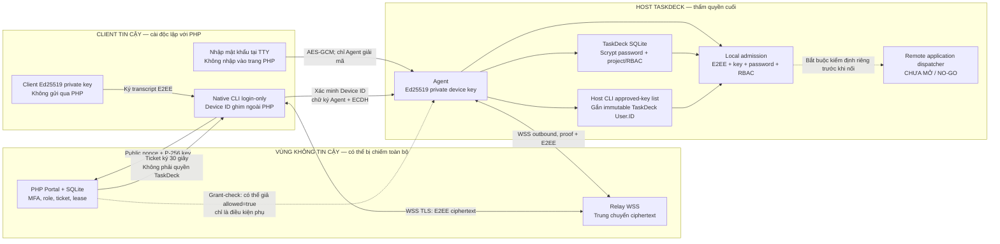
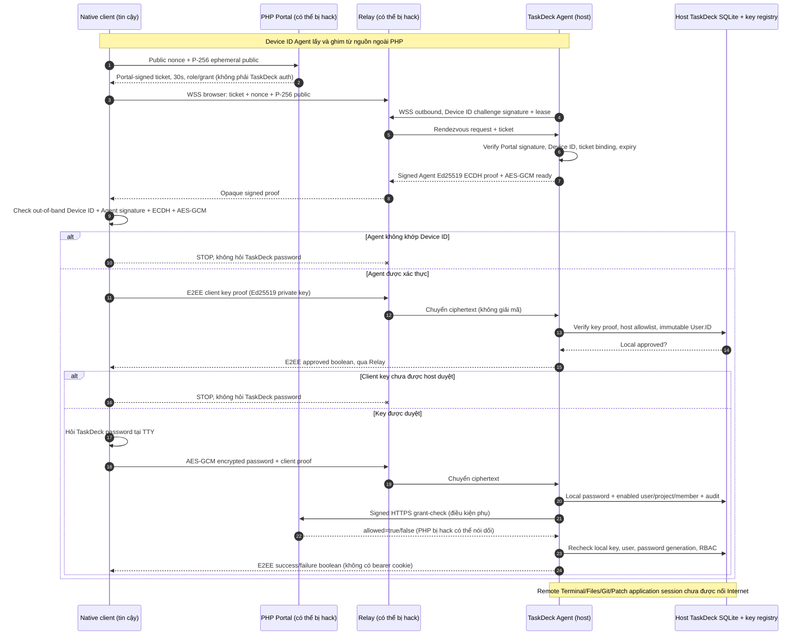

# TaskDeck Remote — Sơ đồ nguyên lý xác minh và chống giả mạo PHP

**Ngày rà soát:** 2026-10-30. **Nhánh:** `feature/taskdeck-remote-access-architecture`.  
**Trạng thái:** triển khai Portal/Relay + native login-only diagnostic; E2EE
application transport / remote session / read-only ping mới ở mức internal
staged, **không được gắn vào production WebSocket/HTTP dispatcher**.
`remote_control_available=false`, Remote Control **NO-GO**.

## 1. Threat model — PHP và Relay đều đã bị chiếm quyền

Đối thủ có quyền đọc/sửa PHP, trang HTML/JavaScript, SQLite Portal,
khóa ký Ed25519 Portal, MFA/grants/roles/ticket/lease và payload Relay.
Giả định họ cấp `admin` và trả `{"ok":true,"allowed":true}` vô điều kiện.
Không giả định chống được DoS, UI phishing hoặc phân phối native client giả
nếu người dùng tải binary từ chính PHP.

Các **bí mật nằm ngoài** PHP: Agent Ed25519 seed của từng workspace trên
host TaskDeck, local host-approved software-client key registry,
client private Ed25519 key trên máy remote đã cài riêng, mật khẩu
TaskDeck / hash / users.id / membership trong DB TaskDeck trên host.
Khi đối thủ lấy được private key client **và** mật khẩu TaskDeck hoặc
chiếm luôn host TaskDeck/đường phát hành native đáng tin, mô hình
bảo vệ này không đủ.

**Kết luận nguyên lý:** khi khóa ký PHP đã bị lộ, `Verify(ticket signature)`
**không thể phân biệt ticket thật với ticket do hacker tạo bằng cùng
khóa**. Đây là giới hạn mật mã, không phải một lỗi có thể giải quyết
bằng thêm chữ ký từ PHP. Không cấp quyền TaskDeck dựa vào ticket.

## 2. Sơ đồ ranh giới tin cậy

**Lưu ý:** mũi tên Native→Agent biểu diễn **quan hệ tin cậy qua Relay
E2EE**, không phải mở cổng mạng vào host; host chỉ kết nối outbound.
Mũi tên grant-check là dữ liệu không đáng tin. PHP bị hack có thể làm
điều kiện Portal cho phép luôn `true` nhưng không tự tạo TaskDeck login.

## 3. Trình tự thực tế hiện tại — native login-only

**Quan trọng:** Diagram trên gồm các giai đoạn trong native login-only
probe hiện có. `StartEncryptedRemoteSession` / action `session.ping`
là **staged internal**, không phải bước đang chạy từ xa trên production
WSS. PHP website chỉ cung cấp ticket/diagnostic không nhập mật khẩu TaskDeck.

## 4. Các điều kiện host phải đồng thời thỏa

| Điều kiện | Tài liệu/mã hiện tại | Bị PHP giả mạo được? |
|---|---|---|
| Portal signing key và ticket, `browser_binding`, JTI, 30s | `remote_portal/src/TicketSigner.php`; `remoteportal/grant.go` | Có, nếu PHP signer bị hack; **không dùng làm local login** |
| Signed Device ID proof, Agent-owned seed và WSS outbound | `remoteportal/agent.go`, `remoteportal/relay.go`, `remoterelay/registry.go` | Không chỉ nhờ PHP; phải sở hữu key Agent |
| Client tự kiểm Device ID và Agent ECDH transcript | `cmd/taskdeck_remote_login/main.go`, `remotetransport/e2ee.go` | Không nếu pin/binary lấy từ nguồn độc lập |
| Host-approved client Ed25519 + User.ID | `remoteclientkey/registry.go`, `remoteportal/agent.go` | Không, chỉ TaskDeck host CLI quản lý |
| TaskDeck password + local project membership | `server/remote_access_session.go`, `server/remote_access_session_login.go` | Không, PHP SQLite khác TaskDeck SQLite |
| Native key proof bắt buộc trước action; workspace Agent binding | `server/remote_access_authorization.go`, `server/remote_access_workspace_agent.go` | Không, trong staged internal tests |
| Mỗi action: local RBAC, key revoke, live grant + cancel | `server/remote_access_execution.go` / session watcher | Nội bộ, chưa có production application route |
| Remote Control | `server/remote_access.go`, `remoterelay/http.go` | **Đang khóa**: `remote_control_available=false` |

## 5. Kịch bản red-team / bất biến

- **PHP có signer + admin + allowed=true:** Agent nhận được ticket
  hợp lệ nhưng không tạo TaskDeck session nếu thiếu approved native client
  proof và password.
- **PHP biết chính xác password TaskDeck nhưng không có private key
  client:** không qua được host native-key gate.
- **PHP sao chép public key đã duyệt + password nhưng private key giả:**
  Ed25519 signature trên E2EE transcript không xác minh được.
- **PHP trả allowed=true sau khi owner revoke key/password/membership:**
  TaskDeck host revalidate và hủy session/action.
- **PHP chỉ định Agent Device ID / Portal origin của workspace khác:**
  từ chối trước khi cấp staged session.
- **PHP/Relay không gửi app ACK:** opaque mailbox tự đóng request sau 20s,
  không cần request tiếp theo; không thể tái sử dụng ACK cũ.
- **PHP gửi forged admin cookie/bearer:** TaskDeck HTTP middleware
  không chấp nhận làm TaskDeck principal.

## 6. Bằng chứng và điều kiện xuất bản

Những thay đổi mới nhất:
- `remote_access_workspace_agent.go` + `remote_access_authorization.go`
  khóa Agent/workspace và native key factor trước app action.
- `remoterelay/app_mailbox.go` thêm timeout chủ động, cancel/pending
  cleanup, generation guard và thử nghiệm concurrent ACK-vs-timeout.

Kiểm thử nền trước thay đổi mailbox:
- [Go CI run 40992679028](https://github.com/hacrot3000/PatchAndCollectionToolForAI/actions/runs/40992679028) — PASS, source `1ca9326d`.
- [PHP CI run 40992679113](https://github.com/hacrot3000/PatchAndCollectionToolForAI/actions/runs/40992679113) — PASS, source `1ca9326d`.

Kiểm thử cho thay đổi mailbox mới:
- [Go CI run 40994280931](https://github.com/hacrot3000/PatchAndCollectionToolForAI/actions/runs/40994280931).
- [PHP CI run 40994280960](https://github.com/hacrot3000/PatchAndCollectionToolForAI/actions/runs/40994280960).
  Chỉ đánh dấu PASS sau khi xác minh cả hai completed/success.

**Khuyến nghị phát hành:** có thể xem xét pilot kiểm thử
Portal/presence/login-only trên môi trường cách ly sau kiểm tra binary
độc lập. **Không đánh dấu GO cho Remote Control** khi RC-01..RC-13
chưa hoàn thiện: production app E2EE/WSS route, typed action dispatcher,
credential revocation end-to-end, OS-specific trusted binary attestation,
NAT/CGNAT/Linux/macOS field test, red team độc lập, DoS/phishing response
và rollback. Tuyệt đối không chuyển `remote_control_available` thành
`true` chỉ dựa trên ticket hoặc hai CI xanh.
