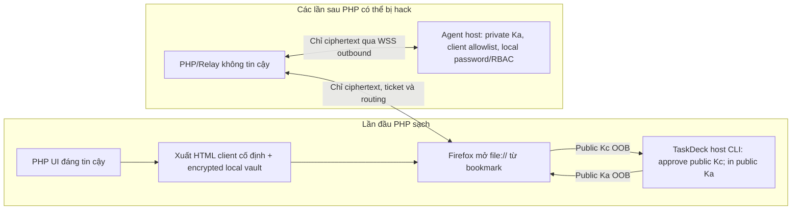

# TaskDeck Remote — Pair lần đầu đáng tin cậy, PHP có thể bị hack toàn bộ về sau

Ngày: 2026-10-30. Nhánh: feature/taskdeck-remote-access-architecture.

## Kết luận thiết kế đã điều chỉnh

User xác nhận **PHP chưa bị chiếm quyền ở lần ghép đôi đầu tiên**;
sau đó mọi HTML/JS/SQLite/API/ticket/lease của PHP đều có thể bị hacker
thay thế. Không cần web portal thứ hai hoặc browser extension.

**Chỉ ghim public key hai bên là CHƯA ĐỦ nếu sau này Firefox vẫn tải
HTML/JavaScript từ PHP.** Mã độc cùng PHP origin có thể đọc password
trước khi E2EE, truy cập IndexedDB cùng origin, điều khiển UI và
dùng cả non-extractable WebCrypto CryptoKey như signing oracle. Không
thể sử dụng một trang PHP đã bị hack để xác thực chính nó bằng chữ ký
của host: trình xác minh JavaScript cũng do hacker sửa. Cũng không
thể dựa vào PWA/Service Worker cache để khóa mã mãi mãi: browser có
thể tự tải cập nhật Worker từ chính origin đã bị hack.

**Phương án không cài thêm server/extension: lúc PHP còn sạch, xuất
một file HTML client ĐỘC LẬP, tự chứa JS/CSS và cặp trust anchors,
người dùng lưu local rồi mở lại bằng bookmark file://.** PHP vẫn là
nơi phát ticket/chuyển tiếp và có thể bị hack về sau, nhưng từ sau
pairing không bao giờ phục vụ mã JavaScript thực thi trên client nữa.
Đây là client được cài bằng 1 file, không cần một portal thứ hai.

Nếu user không chấp nhận ngay cả việc lưu 1 file tin cậy hoặc một
cơ chế đóng gói client độc lập, **không thể cam kết chống hoàn toàn
trường hợp PHP đổi mã giao diện sau khi ghép đôi bằng browser bình
thường**. Đây là ranh giới nền tảng của same-origin web security,
không phải vấn đề số lượng khóa.

## Quy trình đề xuất

1. **Lần đầu, PHP đáng tin:** xuất trọn vẹn giao diện điều khiển
   một file HTML với JavaScript/CSS đóng gói, không import code từ
   PHP hoặc nguồn mạng. Client tạo Ed25519 Kc, chỉ xuất Kc_public.
2. Người dùng trên host chạy `taskdeck remote-key --workspace <path>
   add <username> <client-public-key>`. Host kiểm user.id TaskDeck
   và ghi allowlist owner-only.
3. Host hiển thị khóa định danh Agent ĐÃ CÓ bằng `taskdeck remote-key
   --workspace <path> host-key`. Client ghi/ghim public Ka/Device ID
   từ bảng lệnh host, KHÔNG tin dữ liệu PHP cung cấp về khóa này.
4. Client tạo **vault cục bộ chỉ chứa PRIVATE Kc đã mã hóa** với
   AES-GCM, salt + KDF đủ mạnh và passphrase do người dùng giữ.
   Trình duyệt cho phép tải bản HTML client *đã đóng gói* và vault
   được bảo vệ; không lưu khóa plaintext. Trước khi công bố ra
   production phải làm prototype Firefox để chọn giữa file HTML
   kèm encrypted vault và kho lưu local hoạt động bền vững; không
   mặc định IndexedDB của file:// được bảo đảm tương thích.
5. **Các lần sau:** mở bookmark local file; không truy vấn PHP để
   tải/verify HTML/JS. Mở vault, đối chiếu Ka đã ghim; tạo ephemeral
   ECDH P-256 và ký transcript bằng Kc_private. TaskDeck host xác
   minh Kc trong local allowlist, Ka/pinned Device ID, mật khẩu
   TaskDeck và RBAC từng action. Relay/PHP chỉ đưa tin/nhận ciphertext.
6. Update chương trình HTML bằng bản phát hành **đã được kiểm tra
   chữ ký hoặc hash trên kênh ngoài PHP**. Không cho mã PHP thay
   local file/secret/vault. Bất kỳ mismatch hoặc đổi khóa Agent
   chưa được owner xác nhận phải DENY. Không auto-enroll từ PHP.

## Sơ đồ

Mũi tên `Local↔Evil` minh họa traffic, không cho phép JS của PHP
chạy trong trang local. Agent luôn kết nối outbound; không mở port
inbound vào máy TaskDeck.

## Hệ quả Firefox và Relay cần kiểm thử

- `file://` thường được coi là **secure context** cho WebCrypto;
  origin file có thể là **opaque/null**. Việc lưu IndexedDB và xử
  lý CORS từ file:// khác nhau theo trình duyệt; thử trên đúng
  Firefox trước khi chọn layout vault. Không dựa vào file origin
  như cơ chế xác thực.
- WebSocket `Origin: null` có thể được tạo bởi các opaque origins
  khác (ví dụ iframe sandboxed trên PHP đã hack). **Tuyệt đối không
  xem Origin:null là chứng cứ rằng request đến từ file client
  đáng tin cậy**. Relay phải kiểm quota, replay và host phải xác
  minh client Kc proof trên transcript, Ka/pin, local password/RBAC
  trước bất cứ action nào.
- PHP có thể tự ký ticket và return grant-check allowed=true,
  gây DoS, phishing, cắt kết nối; điều đó KHÔNG cho phép tạo quyền
  TaskDeck nếu private Kc/Ka và TaskDeck local credential vẫn an
  toàn. Xác minh/scrub request payload và log để không lộ bí mật.
- Kc private được mã hóa trên đĩa chỉ chống rò rỉ khi file bị sao
  chép, không ngăn local malware hoặc browser compromise. Đừng
  dùng cùng mật khẩu PHP để bảo vệ vault.
- Không chấp nhận Service Worker hay browser cache là sự bảo đảm
  frozen-code; browser có thể cập nhật JS/SW qua HTTP từ PHP về sau.

## Trạng thái triển khai

Mã nguồn hiện tại có native login-only client, Client Ed25519,
Agent Ed25519 + pinned Device ID, host CLI approve/list/revoke +
host-key, E2EE and RBAC gates. Nhưng chưa có **offline HTML client
đóng gói**, chưa có encrypted portable vault, chưa có browser
file:// interoperability proof, chưa có dedicated local-file WSS
transport và chưa có production application dispatcher.

Mã `/v1/trusted-web` và flag `-trusted-web-origin` được thêm trong
phương án một portal tĩnh thứ hai sẽ được hoàn tác, vì không đáp
ứng yêu cầu UX mới. Không mở route `Origin:null` khi chưa hoàn tất
native-key authentication gắn với browser file and quotas.

**Giữ nguyên `remote_control_available=false`, Remote Control NO-GO**.
Tiêu chuẩn GO chỉ dành cho trường hợp PHP bị hack sau pairing cần
có ít nhất: offline browser client chạy thật trong Firefox; app
route Agent↔Relay↔Client; key proof/revocation + scrypt password
+ per-action RBAC; negative red-team kiểm PHP inject HTML/JS,
forge signature, replay, wrong Device ID và file/agent restart;
field test trên Linux/macOS/NAT; backup và rollback.

Nguồn độc lập đã đối chiếu:
- MDN Secure contexts: file URLs có thể là trustworthy contexts.
- MDN Same-origin policy: file origins often opaque/implementation-dependent.
- MDN Origin header: Origin:null không định danh duy nhất file://.
- MDN Service Worker update: SW có thể được cập nhật từ origin.

## Implementation checkpoint — Firefox offline first-pair client (2026-10-30)

**Implemented, NOT full Remote Control:** `remote_portal/offline/taskdeck_offline_client.html`
is a standalone, self-contained HTML/CSS/JS file intended to be downloaded
**once** while PHP is still trusted, then opened from local disk in Firefox.
Portal's authenticated `GET /offline-client` sends it as
`Content-Disposition: attachment` and `application/octet-stream`;
anonymous and incomplete-MFA sessions cannot download it. The HTML is
stored outside the PHP document root and the PHP website does NOT execute
its private-key code. No application WebSocket or TaskDeck action is enabled.

First-time owner procedure:

1. Sign in to the clean PHP Portal with MFA, click
   **Tải client Firefox OFFLINE để ghép đôi**; save the HTML in a trusted
   local directory. Bookmark its local `file://` URL. Do not update this
   code by downloading another copy from PHP once paired.
2. Open that local HTML in Firefox; enter the **TaskDeck local username**
   and click create Ed25519 key. Copy only the public key.
3. On the REAL TaskDeck host, run:
   `taskdeck remote-key --workspace /absolute/project add USER PUBLIC_KEY`
   (host local CLI checks SQLite user ID + enabled project membership).
   Then run `taskdeck remote-key --workspace /absolute/project host-key`.
   This **only reads the existing Agent identity**, never creates it.
4. Copy the displayed Agent Ed25519 public key into the local HTML,
   calculate SHA-256 Device ID there and check it against the host's
   displayed Device ID directly. Never accept a replacement key from PHP.
5. Use a unique strong local vault password (minimum 16 chars; not Portal
   or TaskDeck password) and download `taskdeck-offline-vault.json`.
   The vault stores public keys / Agent Device ID + PBKDF2-SHA256 salt
   (600,000 iterations) + AES-256-GCM IV and encrypted client private
   PKCS8. Neither private key nor plaintext TaskDeck credentials are sent
   to PHP. Keep a backup of HTML/vault; a lost vault requires revoke
   and re-pair on the host.
6. Re-open the *same* offline HTML, import the encrypted JSON vault
   and verify unlock locally. It validates Ed25519 client public/private
   consistency and pinned Agent Device ID without any network traffic.

Automated tests:
- `remote_portal/tests/offline_client.test.cjs`: evaluates the **actual
  embedded JS** through Node WebCrypto, checks cryptographic roundtrip and
  rejects wrong password, swapped pubkey, tampered user/pin/AEAD ciphertext.
- `remote_portal/tests/credential_boundary.test.cjs`: forbids long-lived
  client crypto/private-key storage in PHP-served online page and checks
  the attachment-only authenticated delivery.
- `remote_portal/tests/mfa_http.php`: real local PHP HTTP checks
  unauthorized download denial, MFA gate, attachment header, and success
  after MFA enrollment.
- Both Go and PHP workflows were green on source `efa43546` before
  this feature; for the new HTML, the PHP workflow on source
  `84fbee28f92aba738c299e809cd8524b39312b81` is
  [SUCCESS](https://github.com/hacrot3000/PatchAndCollectionToolForAI/actions/runs/41003844995).

**Security limit / remaining work:** this milestone is **first-pair
encryption only**. It does NOT connect to TaskDeck over the Internet,
does NOT currently use client signing key for login/application traffic
from Firefox and does NOT make a remote command available. The future
client-on-wire MUST verify Agent-signed E2EE transcripts, sign a
one-use client challenge with the approved private key, and be checked
against the host's local credentials and RBAC before each action; a
malicious PHP must never be able to provide executable JS updates.
Firefox `file://` + actual Relay interoperability and physical NAT
tests remain necessary. Keep `remote_control_available=false`.

## Đợt tiếp 2026-10-30: Firefox offline E2EE diagnostics over Relay (KHÔNG CẤP REMOTE)

**Luồng sử dụng thực tế trong local HTML:**
1. Trên host đã có khóa Agent và host allowlist, client mở bản HTML file:// đã lưu từ lần PHP sạch.
2. Nhập kho khóa JSON + mật khẩu vault; HTML giải mã/kiểm local pin Device ID rồi xóa mật khẩu khỏi trường nhập.
3. Bước 5, nhập **Relay HTTPS origin** cố định từ cấu hình đã xác minh trước đó, nhấn "Tạo mã phiên và khóa ECDH dùng một lần".
4. Sao chép **chỉ** client nonce và P-256 public key công khai vào giao diện cấp ticket trên PHP. PHP chỉ phát ticket 30s; dù đã bị hacker chiếm quyền cũng không có private key client/Agent.
5. Dán ticket vào HTML offline; bấm "Kiểm tra chữ ký Agent và 3 vòng E2EE". Trình duyệt kết nối `wss://RELAY_HOST/v1/offline` và xác minh:
   - Portal ticket là dữ liệu rendezvous không tin cậy; Relay chỉ đưa gói đã có định dạng cố định.
   - Agent reachability Ed25519 signature với đúng raw public key được ghim trong kho khóa, 32-byte nonce và probe ID.
   - Agent ECDH ephemeral P-256 được ký bằng đúng khóa Agent Ed25519, binding toàn bộ E2EE transcript và SHA-256 Device ID đã ghim.
   - HKDF-SHA256(72 byte) => AES-256-GCM hai chiều, AAD chứa transcript hash/direction/sequence.
   - Authenticated ready message của Agent (seq=1), sau đó **tối đa 3 vòng** AES-GCM nonce echo qua Relay, đúng thứ tự, không pipeline/replay.
6. Firefox báo thành công chỉ khi đủ 3 reply AEAD đã xác minh. Nếu Agent key khác, chữ ký giả, nonce sai, gói AES-GCM sai hay mất mạng => từ chối; không cấp quyền TaskDeck.

**Relay:** opt-in mới `taskdeck_remote_relay -allow-offline-file-client`; mặc định **false**. Chỉ mở endpoint chẩn đoán WSS `/v1/offline`, yêu cầu `Origin: null` chính xác, không query, dùng rate-limit/replay/quota của browserSocket trước đây. **Origin:null không xác thực browser tin cậy**: HTML sandboxed trên PHP bị hack cũng có thể gửi Origin:null; host-public-key crypto và future approved-client proof/password mới là ranh giới bảo mật. Không cho JavaScript do PHP phát hành chạy trong file client offline và không nhập password TaskDeck vào PHP. PHP vẫn có thể DoS/giả tickets, nhưng không làm giả Agent transcript khi Agent seed còn an toàn.

**CI kiểm chứng:** 
- Go Agent/Relay source `eb34b39dd21250314f3ee9311af91ab1fdd08c90`: [CI PASS #41004510406](https://github.com/hacrot3000/PatchAndCollectionToolForAI/actions/runs/41004510406), gồm WSS Origin:null opt-in test, PHP-origin denied, default disabled, cross-build/race red-team.
- Node WebCrypto `remote_portal/tests/offline_e2ee_crypto.test.cjs` dùng **JS thật nhúng trong HTML**, Agent signing Ed25519 thật, ECDH/P-256/HKDF và AES-GCM tương thích định dạng Go. Kiểm 3 lượt stop-and-wait, giả chữ ký/Device ID/ECDH/ready/nonce và poison sau gói giả. Test này chỉ chứng minh crypto implementation trong Node; **chưa phải test trên trình duyệt Firefox thật**.

**Giới hạn phát hành còn nguyên:**
- Chẩn đoán E2EE **không** gửi private Ed25519 client key, plaintext TaskDeck password, cookie/username TaskDeck, command. Chưa thực hiện trusted-host client-key preflight trên HTML và chưa thực hiện password-bound login.
- `/v1/offline` đang dùng fixed diagnostic envelope, **không** kết nối production application dispatcher, không có Terminal/Files/Git/Patch/Collection action.
- Chưa thử file:// qua Firefox thật, TLS/CGNAT/NAT/linux/macOS host thật; chưa đủ GO.
- `remote_control_available=false` phải giữ nguyên. Không dùng `Origin:null`, ticket PHP hoặc browser pin như capability thực thi.

## Bổ sung — host-approved client private-key possession (offline Firefox)

Đã bổ sung bước thứ hai của native client E2EE, **không cần browser extension
hoặc portal thứ hai**:

1. Sau khi giải mã vault tại Firefox local file, private Ed25519 key được
   import thành WebCrypto `CryptoKey` non-extractable để **chỉ ký trong bộ
   nhớ**, không xuất private PKCS8 qua PHP/Relay. Vault JSON trên đĩa vẫn
   được bảo vệ bởi PBKDF2-SHA256(600k)+AES-256-GCM.
2. Dùng đúng handshake Agent Ed25519 và ephemeral P-256, rồi thực hiện
   `taskdeck-e2ee-client-key-check-v1` bên trong AES-256-GCM. Client ký
   **chính xác** `taskdeck-remote-client-login-v1 || 0x00 || ASCII-lower(username) ||
   0x00 || SHA256(E2EE transcript)`.
3. Agent kiểm chữ ký client Ed25519, host-owned registry approved key
   gắn với TaskDeck SQLite `User.ID`; chỉ Agent biết kết quả.
4. Firefox nhận một gói `e2ee_client_key_check_result` với ciphertext AES-GCM
   authenticated, kiểm `taskdeck-e2ee-client-key-status-v1` và
   `approved: true|false`. Bất kỳ status thuần từ PHP/Relay, ciphertext
   bị sửa, replay hoặc payload sai schema đều không được chấp nhận.
5. Trạng thái E2EE **one-shot** sau khi trả về kết quả. Client không
   tự động gửi mật khẩu hoặc biến kết quả approved thành quyền TaskDeck.
   Mỗi lần thử dùng khóa ECDH mới/nonce mới/ticket mới; PHP không thể
   copy public key hay phát lại chữ ký của lượt trước để mạo danh.
6. Trên Go Relay, `/v1/offline` **tuyệt đối không nhận e2ee_login**
   dù đã thực hiện key-check. Đã tách chính sách
   `allowedBrowserProtectedTransitionForRoute` và bổ sung unit test.
   Native `/v1/browser` login-only vẫn giữ nguyên.

**Chỉ dẫn UI:** Sau khi mở vault, nhập Relay HTTPS origin, bấm chuẩn bị
nonce/ephemeral public, copy hai thông tin công khai vào PHP xin ticket,
paste ticket, rồi bấm "Kiểm tra khóa client được host duyệt".
Kết quả thành công chứng minh khóa private thuộc registry host tại thời
điểm Agent kiểm — **không** đăng nhập TaskDeck, không cấp capability/token
hay quyền Terminal/Files/Git/Patch. Không bật `remote_control_available`.

Kiểm thử:
- Node WebCrypto `remote_portal/tests/offline_e2ee_crypto.test.cjs`
  kiểm chữ ký E2EE-transcript bằng client Ed25519, xác minh signature
  bằng public key thật, phản hồi approved/denied dưới AEAD và
  poison-on-forgery; kiểm cả PHP admin giả mạo status.
- Go `TestOfflineFileRouteNeverAcceptsTaskDeckPasswordOrApplicationFrame`
  xác nhận offline route deny login/terminal/file operations, bất kể
  preflight thành công.

**Chưa hoàn thành để lên live:** chưa có trình duyệt Firefox chạy test
trực tiếp trên file:// và mạng WSS thật, chưa có E2EE password authentication
flow cho Firefox offline (đang CỐ Ý khóa), chưa có ứng dụng remote
Terminal/Files/Git/Patch sau per-action RBAC; chưa có NAT/CGNAT Linux/macOS
field test và red-team độc lập. Client và Agent local-compromise nằm ngoài
phạm vi giả định PHP-only. `remote_control_available=false` vẫn bắt buộc.

## Kết quả CI cuối của đợt E2EE offline + client-key preflight

**Verified source:** `8577f5cc298b1dca970f99795275398c67fa2b07`.
Hai workflow trên **cùng source SHA** đã completed/success:
- [Go Agent / Relay CI #41005763889](https://github.com/hacrot3000/PatchAndCollectionToolForAI/actions/runs/41005763889): PASS, gồm red-team PHP/Relay, race tests, kiểm thử /v1/offline no-password policy, cross-build macOS/Linux ARM.
- [PHP Portal / Node WebCrypto CI #41005763878](https://github.com/hacrot3000/PatchAndCollectionToolForAI/actions/runs/41005763878): PASS, gồm mật mã E2EE của HTML offline thực, host-approved client key Ed25519 signature binding, forged/denied/replayed encrypted verdict, HTTP MFA-gated download.

Lưu ý: bộ CI trên không mô phỏng được toàn bộ Firefox file://
và mạng/host NAT thật; **đó là release gate còn thiếu**. 
`remote_control_available=false`, và đường offline từ chối password/login
frames dù key-preflight thành công. Không quảng bá GO Remote Control.

## Xác nhận CI sau login-only và ticket UX (2026-10-30)

**CI PASS đã xác minh (tránh trộn SHA):**

- Go Agent/Relay, source `1352258b7200dbd196a536d67cbbca5593fd24ca`:
  [workflow #41006883306 — completed SUCCESS](https://github.com/hacrot3000/PatchAndCollectionToolForAI/actions/runs/41006883306).
  Cùng SHA đó, [PHP #41006883310 — SUCCESS](https://github.com/hacrot3000/PatchAndCollectionToolForAI/actions/runs/41006883310).
- Firefox offline HTML WebCrypto login-v2 regression, source
  `a8326a8c31986718a7327e4b7afffa9a732875a9`:
  [PHP/Node #41007290941 — SUCCESS](https://github.com/hacrot3000/PatchAndCollectionToolForAI/actions/runs/41007290941).
  Chống gọi mật khẩu trước Agent/client key approval, phủ nhận host key,
  đáp ứng login-result AEAD/sequence, sửa lỗi test lấy transcript của
  phiên E2EE khác.
- UI nhập ticket JSON thuần (hai trường `ticket`,
  `expires_in_seconds:30`), chống field lạ, và xử lý Relay đóng
  WSS sau phản hồi đã chuyển cho WebCrypto kiểm tra:
  source `1e2821d82372d22090f6464f6372a7fc36537492`,
  [PHP/Node #41007686079 — completed SUCCESS](https://github.com/hacrot3000/PatchAndCollectionToolForAI/actions/runs/41007686079).

**Cảnh báo quan trọng:** các lần CI phía PHP chỉ kiểm tra Node WebCrypto
và PHP HTTP tests, **không thay thế** việc chạy file `file://` thật
bằng Firefox và tác vụ NAT/CGNAT. Go CI được xác minh ở source code
có thay đổi Go gần nhất; sau đó chỉ chỉnh HTML/tests/docs.
Nguồn PHP bị hack về sau vẫn có thể DoS/phishing, nhưng không được
chạy JS trên local offline client.

Cờ mới `-allow-offline-login-probe` phải do operator bật trên Go
Relay và chỉ hợp lệ khi đồng thời `-allow-offline-file-client`.
Mặc định cả hai false. Mở đường này chỉ phục vụ **boolean login-only**;
server Agent vẫn xác thực `User.ID`, approved Ed25519 client key,
TaskDeck password và local project membership/RBAC. Không mount remote
terminal, files, Git/Patch hoặc ứng dụng bất kỳ.

**Còn thiếu bắt buộc trước LIVE:** Firefox thật qua TLS WSS với PHP
bị sửa sau pairing, test host Linux/macOS sau NAT/CGNAT, full
application dispatcher với per-action authorization, revoke, stream,
trusted client distribution/update và independent red team.

`remote_control_available=false` không được đổi. **NO-GO Remote
Control**. `approved:true` hoặc `authenticated:true` trong
kết quả đã mã hóa vẫn **không phải** capability hoặc session token.

## Final second-audit CI closure — 2026-10-30 (supersedes pending Go CI status above)

**Verified code commit:** `8d058701fc5b407982b05a5af12489b7ba5a363b`
on `feature/taskdeck-remote-access-architecture`.

- [Go Agent/Relay workflow #41015956184](https://github.com/hacrot3000/PatchAndCollectionToolForAI/actions/runs/41015956184):
  **completed SUCCESS**, including `go test -race`, full server
  remote security suite, compromised-PHP/Relay tests, CLI key checks
  and cross-compilation for Linux ARM + macOS.
- [PHP Portal/Node WebCrypto workflow #41015956185](https://github.com/hacrot3000/PatchAndCollectionToolForAI/actions/runs/41015956185):
  **completed SUCCESS** on the SAME source SHA, including owner-confirmed
  Agent pin UI, malformed Relay-envelope poison-on-error tests, MFA
  protected offline-client delivery, cryptographic interoperability.

**Additional issue found when re-running Go CI**: the preceding code
`d3a114ff` had one FAIL in
`TestRemoteStagedSessionAutoClosesOnGrantRevocationAndTransportLoss`,
subcase `Portal revoked`. Audit confirmed this was **a race inside
the test itself**, not a successful stale authorization: production
`remoteTaskDeckSession.Close()` deliberately sets `closed=true`
immediately (stopping all future actions) *before* closing the Portal
grant and E2EE Channel while holding `executionMu`. The test checked
only `closed=true`, then immediately asserted both cleanup resources
were already gone. The test is now fixed to await **all three**
security conditions simultaneously, inside the **existing unchanged
2-second bound**. Neither the production Close ordering nor the
security timeout was weakened. Fix:
`8d058701fc5b407982b05a5af12489b7ba5a363b`.
The complete Go CI and PHP CI then both passed.

This source audit does **not** prove browser `file://`/WSS
interoperability in physical Firefox, production NAT/CGNAT, code-update
integrity after first pairing, or absence of every remaining
hacked-PHP-origin UX/phishing risk. No HTTP/WebSocket application
dispatcher has been mounted; password result remains a single
encrypted boolean; `remote_control_available=false` is unchanged.
**Remote Control remains NO-GO** pending physical field tests,
independent penetration testing, and per-action host RBAC/revocation.

## Third security audit — offline Firefox concurrency / identity pin / WSS lifecycle (2026-10-30)

**Baseline:** `2bf51aa8ad1e506ea79201d28332445fabe5b166`.
**Change source:** `b1014b562861e6a2a3b7920e1b07fbc2f4fa5340`.
Threat model remains: PHP/Relay may be completely compromised after the
initial trusted offline HTML download/host-local key pairing. Agent private
Ed25519 key, host registry and genuine Firefox local HTML/vault are trusted.
PHP tickets, admin/role claims, and WSS plaintext envelopes are untrusted.

### Concrete findings and corrections

1. **P1 — concurrent Ed25519 signing could reuse AES-GCM nonce** in
   `sealE2eeClientKeyCheck`. Before the fix, two concurrent calls passed
   `state.sent===0` and both awaited `crypto.subtle.sign` before
   reserving sequence 1. They could each encrypt different payloads using
   the same direction/key/IV. **Fixed** by reserving sequence 1 *before*
   all asynchronous work, poisoning on duplicate/reentrant attempts,
   never transmitting a ciphertext after the channel was poisoned, and
   zeroing the short-lived plaintext Uint8Array. Commit `db9d6079`.
2. **P1 — duplicate incoming Agent verdicts could revive a poisoned
   session**. Key-status verifier and echo verifier previously marked
   state closed while doing async AES-GCM decrypt, but a concurrent
   validation failure could be overwritten by the first successful
   asynchronous callback reopening the state. Login verifier could
   similarly return `authenticated=true` after another concurrent
   call had flagged the session invalid. **Fixed** with monotonic
   `state.poisoned`, checked again after awaited WebCrypto decrypt;
   no key-approved state or login boolean can be resurrected after a
   duplicate/error. Commit `db9d6079`.
3. **P2 — unlocked vault could change during active browser proof**.
   E2EE handshake was comparing Agent proof against the mutable global
   `trustedVault` while client-key check uses an earlier snapshot.
   **Fixed**: immutable `activeVault` captured on WSS start is used
   throughout both checks; importing a second vault while E2EE runs is
   refused, without clearing the active state. Commit `8b5d8090`
   and `22770aa5`.
4. **P2 — Relay disconnect could leave password dialog active**.
   The socket close handler previously ignored close whenever the
   asynchronous `onmessage` handler was running, including the
   interactive 20-second local password prompt. **Fixed**: immediately
   abort/close the dialog on any close during the password prompt, and
   suppress close only while actively verifying the final Agent AEAD
   response (which may race normal WebSocket shutdown). Commit
   `8b5d8090`.
5. **P3 — JS/Go username length mismatch**: Firefox used UTF-16 code
   units while host Go limits usernames by 128 UTF-8 **bytes**.
   **Fixed** client validation to use `TextEncoder` byte count, with
   negative regression for 50 multi-byte characters. Commit
   `22770aa5` and `b1014b56`.

### Regression tests and CI

- Node WebCrypto test `remote_portal/tests/offline_e2ee_crypto.test.cjs`
  now executes the real inline HTML crypto with **simultaneous** key
  sealing, parallel valid key verdicts, parallel echo replies, and
  parallel valid login results. It verifies every duplicated/poisoned
  state rejects, and no valid result opens a closed session. Commit
  `ee8ed823`.
- PHP/Node workflow [#41017666494](https://github.com/hacrot3000/PatchAndCollectionToolForAI/actions/runs/41017666494)
  **completed SUCCESS** on exact source SHA
  `b1014b562861e6a2a3b7920e1b07fbc2f4fa5340`, including the new
  concurrency and UTF-8 tests.
- The latest Go Agent/Relay implementation was **not changed** in this
  audit. Its previous full Go CI at source `8d058701`
  [#41015956184](https://github.com/hacrot3000/PatchAndCollectionToolForAI/actions/runs/41015956184)
  passed. Do **not** imply this is a Go CI run on `b1014b56`.

### Remaining release blockers (unchanged)

- Full trust boundary has NOT been validated with real Firefox `file://`,
  real certificate/TLS/WSS, real TaskDeck host and NAT/CGNAT links.
  A compromised PHP can still DoS, phish users outside the local
  trusted HTML, and cause ticket issuance/revocation errors.
- No trusted offline client auto-updater or authenticated code-distribution
  mechanism exists. An existing local HTML copy is deliberately not
  refreshed from potentially compromised PHP; source-only security fixes
  do NOT automatically propagate to users' previously downloaded copies.
  Any future update needs an independently pinned signing key or direct
  trusted distribution; never automatically execute JS supplied by PHP.
- Login-only result is just an E2EE-authenticated boolean; there is no
  application dispatcher, remote TaskDeck cookie, terminal/files/Git/Patch
  capability, or transferable token on the Firefox offline route.
- Per-action host TaskDeck RBAC/revocation, bounded application stream,
  production deployment and independent compromised-PHP penetration test
  remain mandatory before enabling remote application access.

**GO/NO-GO:** `remote_control_available=false` remains in force.
**NO-GO for Remote Control.** CI success covers audited code paths only,
not Firefox field operation or an absolute security guarantee.

## Fourth security audit — offline vault export integrity under concurrent re-key (2026-10-30)

**Starting HEAD:** `c7cbc620066f7eaa80678b7ba89871c21b699d28`.
**Verified code SHA:** `021a5cd274970ec9a3161d6fa72c156ca5d75788`.

### New confirmed issue — P1 private-key backup corruption

The trusted Firefox single-file UI had an asynchronous vault export:
`makeVault` imported a reference to `pending.pkcs8` and awaited WebCrypto
(Agent key import, Ed25519 test, PBKDF2 600,000 iterations), then finally
encrypted the original `pending.pkcs8` view. Concurrent click on
"Generate client Ed25519 key" called `discardPending()`, which zeroed
the SAME mutable PKCS8 buffer before AES-GCM encrypt. Result: the HTML
could download a cryptographically intact **but undecryptable/invalid
private-key backup**; the matching public key might already have been
approved by the host, stranding the authorized identity. Double export
could also produce confusing duplicate backups.

**Fix (source `0048d85491ae81406cc2a6f283a19ee356152f32`):**
- `makeVault` validates then copies the PKCS8 into a private snapshot
  **synchronously before its first await** and uses only that snapshot
  for Ed25519 private-key import and AES-GCM vault encryption.
- Wipes the temporary snapshot using `finally` after success or error.
- The pairing UI serializes key generation, Agent verification and
  vault export using in-flight flags. It disables the export button
  during work; rejects concurrent re-key/double export; rechecks
  username, Agent public key and the out-of-band Device ID confirmation
  before actually downloading; clears vault passphrase fields on
  completion/error.
- Never claims a saved/downloaded private-key backup is durable merely
  because a Blob URL was generated. The user must keep/verify the file.

**Regression tests (source `021a5cd274970ec9a3161d6fa72c156ca5d75788`):**
- `remote_portal/tests/offline_client.test.cjs`: begins vault
  encryption, **immediately wipes the input PKCS8 before the first
  WebCrypto await completes**, then opens the encrypted vault
  and verifies the original client key is still recoverable.
  This previously would have exported a damaged private key.
- `remote_portal/tests/offline_pairing_gate.test.cjs`: runs the
  **actual HTML click handlers** while PBKDF2 export is active;
  attempts re-key and duplicate export and confirms only one
  download, the original public key remains intact, the export
  button stays disabled until completion and the passphrase
  field is erased.

### Evidence

[PHP Portal/Node WebCrypto workflow #41018968495](https://github.com/hacrot3000/PatchAndCollectionToolForAI/actions/runs/41018968495)
**completed SUCCESS**, matching exact source
`021a5cd274970ec9a3161d6fa72c156ca5d75788`.
Go Agent/Relay source was NOT changed in this audit;
its last full run [#41015956184](https://github.com/hacrot3000/PatchAndCollectionToolForAI/actions/runs/41015956184)
completed SUCCESS on its own previous source SHA. **Do not**
claim same-SHA Go CI verification for this fourth audit.

### Unresolved gates and restrictions

- No real Firefox `file://` test of OS download permissions, browser
  user-activation policies or WSS over a deployed HTTPS Relay.
  Even a browser-initiated Blob download is not proof it was
  written durably; require user-side backup/re-import before
  relying solely on the exported encrypted vault.
- No NAT/CGNAT/physical Linux/macOS validation, trusted client
  signed-update workflow, complete TaskDeck application action
  dispatcher, independent compromised-PHP penetration test or
  final per-action host RBAC/revocation verification.
- Continue to treat PHP/Relay as untrusted after pairing and
  `Origin:null` as non-identifying. Do not execute refreshed
  PHP JavaScript inside the already-paired offline client.

**Release status: `remote_control_available=false`, NO-GO Remote
Control.** Login-only returns an Agent-authenticated boolean, not
a TaskDeck capability or HTTP/WebSocket application session.

## Fifth security audit — stale vault identity / asynchronous unlock / active WSS cancellation (2026-10-30)

**Audit baseline:** `46968e4aaaa3a83b8714ed746528dd290a7d56d5`.
**Latest source under test:** `30ea6dd8f8558405606c97f91360414bacff19e7`.
No application-remote route or TaskDeck action dispatcher is enabled.

### Findings and fixes

1. **P1 — stale authenticated client vault after selecting another file**.
   `vault-file` selection previously left `trustedVault` and the
   existing ECDH `offlineProbe` intact until the user clicked Unlock
   and finished AES-GCM/PBKDF2. Clicking Prepare/Connect in between
   could use a *different previously unlocked client's* Agent pin and
   signing key rather than the newly selected vault. **Fixed**:
   changing the selected file immediately invalidates cached trust,
   clears nonce and public ECDH display, and requires a fresh
   successful unlock before any further outbound attempt.

2. **P1 — asynchronous file read/decrypt can authorize an obsolete file**.
   The old Unlock handler allowed multiple overlapping clicks and
   committed whichever `openVault()` resolved last. **Fixed**:
   `unlockBusy` serializes unlock; the previous trusted key is
   revoked synchronously before reading the file or deriving the
   PBKDF2 key. A monotonically increasing file-selection generation
   plus exact file-object check is verified both after `file.text()`
   and after the actual crypto verification. A changed file's
   in-flight result is discarded; the password field is cleared
   and the button restored in `finally`.

3. **P2 — concurrent ECDH Prepare could overwrite copied nonce/key**.
   Previously duplicate clicks on `makeE2eeProbe()` could race
   over `offlineProbe` and the displayed values, causing a Portal
   ticket to be issued for a different key from the one used during
   WSS handshake. **Fixed**: serializing with `prepareBusy`,
   blocking Prepare/Connect while unlocking or active WSS, and
   validating that the trusted vault and Relay origin are unchanged
   before publishing a newly generated ECDH key. Changing Relay
   origin clears prepared nonce and key.

4. **P1 — changing vault mid-WSS could finish a login with old identity**.
   The E2EE socket captured `activeVault` correctly but a subsequent
   user-selected vault change left that socket running, possibly
   displaying a success against the old host after the user already
   switched identities. **Fixed** by revoking the active WSS on
   vault-selection change. The one-shot `activeOfflineAbort`
   invokes the same fail-closed `finish` path, closes WSS,
   aborts any active local TaskDeck password dialog and rejects
   the pending operation. A late ciphertext cannot turn the
   aborted state into success.

**Code commits:**
- `c76fb955e970ca5fcd5ae1cc3e68bebdc69c216c` —
  invalidate old vault, serialize unlock and ECDH.
- `94bcf998722e70e6b40ea8722bfd2ddbdb535998` —
  revoke live WSS on vault switch.
- `bd0c6ee1396476067b8841a6188b7a76f3a56d5f` —
  introduce true HTML listener regression and hook into CI.
- `30ea6dd8f8558405606c97f91360414bacff19e7` —
  test live WSS cancellation on vault change.

### Verified CI

- [PHP Portal / Node WebCrypto workflow #41020570369](https://github.com/hacrot3000/PatchAndCollectionToolForAI/actions/runs/41020570369)
  **completed SUCCESS** at source `30ea6dd8f8558405606c97f91360414bacff19e7`.
  Includes actual HTML listener tests with a pending file-read,
  changing selected vault during unlock, stale-session prevention,
  concurrent ECDH preparation and a fake WebSocket that must
  close immediately when the user switches vault.
- [Go Agent / Relay workflow #41020233978](https://github.com/hacrot3000/PatchAndCollectionToolForAI/actions/runs/41020233978)
  **completed SUCCESS** at source `bd0c6ee1396476067b8841a6188b7a76f3a56d5f`.
  The two subsequent commits only changed the offline HTML and
  Node test. Do not claim Go CI was run on the final HTML source.

### Remaining limits and NO-GO

These are source-level and Node WebCrypto tests, not Firefox's native
`file://` browser UX, hardware download persistence, live WSS
TLS/certificate checks, real Linux/macOS NAT/CGNAT or compromised
PHP red-team field tests. Offline HTML updates are not securely
delivered to existing downloaded local copies; upgrading must not
run untrusted JS from a newly compromised PHP Portal.

`remote_control_available=false` remains mandatory.
An approved Ed25519 client key, successful E2EE handshake or valid
TaskDeck password probe yields only a one-shot boolean: **no**
remote session token, Terminal/Files/Git/Patch, arbitrary command
execution or app dispatcher. **Remote Control remains NO-GO.**
