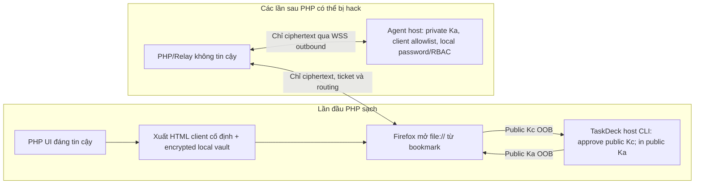

# TaskDeck Remote — Pair lần đầu đáng tin cậy, PHP có thể bị hack toàn bộ về sau

Ngày: 2026-10-30. Nhánh: feature/taskdeck-remote-access-architecture.

## Kết luận thiết kế đã điều chỉnh

User xác nhận **PHP chưa bị chiếm quyền ở lần ghép đôi đầu tiên**;
sau đó mọi HTML/JS/SQLite/API/ticket/lease của PHP đều có thể bị hacker
thay thế. Không cần web portal thứ hai hoặc browser extension.

**Chỉ ghim public key hai bên là CHƯA ĐỦ nếu sau này Firefox vẫn tải
HTML/JavaScript từ PHP.** Mã độc cùng PHP origin có thể đọc password
trước khi E2EE, truy cập IndexedDB cùng origin, điều khiển UI và
dùng cả non-extractable WebCrypto CryptoKey như signing oracle. Không
thể sử dụng một trang PHP đã bị hack để xác thực chính nó bằng chữ ký
của host: trình xác minh JavaScript cũng do hacker sửa. Cũng không
thể dựa vào PWA/Service Worker cache để khóa mã mãi mãi: browser có
thể tự tải cập nhật Worker từ chính origin đã bị hack.

**Phương án không cài thêm server/extension: lúc PHP còn sạch, xuất
một file HTML client ĐỘC LẬP, tự chứa JS/CSS và cặp trust anchors,
người dùng lưu local rồi mở lại bằng bookmark file://.** PHP vẫn là
nơi phát ticket/chuyển tiếp và có thể bị hack về sau, nhưng từ sau
pairing không bao giờ phục vụ mã JavaScript thực thi trên client nữa.
Đây là client được cài bằng 1 file, không cần một portal thứ hai.

Nếu user không chấp nhận ngay cả việc lưu 1 file tin cậy hoặc một
cơ chế đóng gói client độc lập, **không thể cam kết chống hoàn toàn
trường hợp PHP đổi mã giao diện sau khi ghép đôi bằng browser bình
thường**. Đây là ranh giới nền tảng của same-origin web security,
không phải vấn đề số lượng khóa.

## Quy trình đề xuất

1. **Lần đầu, PHP đáng tin:** xuất trọn vẹn giao diện điều khiển
   một file HTML với JavaScript/CSS đóng gói, không import code từ
   PHP hoặc nguồn mạng. Client tạo Ed25519 Kc, chỉ xuất Kc_public.
2. Người dùng trên host chạy `taskdeck remote-key --workspace <path>
   add <username> <client-public-key>`. Host kiểm user.id TaskDeck
   và ghi allowlist owner-only.
3. Host hiển thị khóa định danh Agent ĐÃ CÓ bằng `taskdeck remote-key
   --workspace <path> host-key`. Client ghi/ghim public Ka/Device ID
   từ bảng lệnh host, KHÔNG tin dữ liệu PHP cung cấp về khóa này.
4. Client tạo **vault cục bộ chỉ chứa PRIVATE Kc đã mã hóa** với
   AES-GCM, salt + KDF đủ mạnh và passphrase do người dùng giữ.
   Trình duyệt cho phép tải bản HTML client *đã đóng gói* và vault
   được bảo vệ; không lưu khóa plaintext. Trước khi công bố ra
   production phải làm prototype Firefox để chọn giữa file HTML
   kèm encrypted vault và kho lưu local hoạt động bền vững; không
   mặc định IndexedDB của file:// được bảo đảm tương thích.
5. **Các lần sau:** mở bookmark local file; không truy vấn PHP để
   tải/verify HTML/JS. Mở vault, đối chiếu Ka đã ghim; tạo ephemeral
   ECDH P-256 và ký transcript bằng Kc_private. TaskDeck host xác
   minh Kc trong local allowlist, Ka/pinned Device ID, mật khẩu
   TaskDeck và RBAC từng action. Relay/PHP chỉ đưa tin/nhận ciphertext.
6. Update chương trình HTML bằng bản phát hành **đã được kiểm tra
   chữ ký hoặc hash trên kênh ngoài PHP**. Không cho mã PHP thay
   local file/secret/vault. Bất kỳ mismatch hoặc đổi khóa Agent
   chưa được owner xác nhận phải DENY. Không auto-enroll từ PHP.

## Sơ đồ

Mũi tên `Local↔Evil` minh họa traffic, không cho phép JS của PHP
chạy trong trang local. Agent luôn kết nối outbound; không mở port
inbound vào máy TaskDeck.

## Hệ quả Firefox và Relay cần kiểm thử

- `file://` thường được coi là **secure context** cho WebCrypto;
  origin file có thể là **opaque/null**. Việc lưu IndexedDB và xử
  lý CORS từ file:// khác nhau theo trình duyệt; thử trên đúng
  Firefox trước khi chọn layout vault. Không dựa vào file origin
  như cơ chế xác thực.
- WebSocket `Origin: null` có thể được tạo bởi các opaque origins
  khác (ví dụ iframe sandboxed trên PHP đã hack). **Tuyệt đối không
  xem Origin:null là chứng cứ rằng request đến từ file client
  đáng tin cậy**. Relay phải kiểm quota, replay và host phải xác
  minh client Kc proof trên transcript, Ka/pin, local password/RBAC
  trước bất cứ action nào.
- PHP có thể tự ký ticket và return grant-check allowed=true,
  gây DoS, phishing, cắt kết nối; điều đó KHÔNG cho phép tạo quyền
  TaskDeck nếu private Kc/Ka và TaskDeck local credential vẫn an
  toàn. Xác minh/scrub request payload và log để không lộ bí mật.
- Kc private được mã hóa trên đĩa chỉ chống rò rỉ khi file bị sao
  chép, không ngăn local malware hoặc browser compromise. Đừng
  dùng cùng mật khẩu PHP để bảo vệ vault.
- Không chấp nhận Service Worker hay browser cache là sự bảo đảm
  frozen-code; browser có thể cập nhật JS/SW qua HTTP từ PHP về sau.

## Trạng thái triển khai

Mã nguồn hiện tại có native login-only client, Client Ed25519,
Agent Ed25519 + pinned Device ID, host CLI approve/list/revoke +
host-key, E2EE and RBAC gates. Nhưng chưa có **offline HTML client
đóng gói**, chưa có encrypted portable vault, chưa có browser
file:// interoperability proof, chưa có dedicated local-file WSS
transport và chưa có production application dispatcher.

Mã `/v1/trusted-web` và flag `-trusted-web-origin` được thêm trong
phương án một portal tĩnh thứ hai sẽ được hoàn tác, vì không đáp
ứng yêu cầu UX mới. Không mở route `Origin:null` khi chưa hoàn tất
native-key authentication gắn với browser file and quotas.

**Giữ nguyên `remote_control_available=false`, Remote Control NO-GO**.
Tiêu chuẩn GO chỉ dành cho trường hợp PHP bị hack sau pairing cần
có ít nhất: offline browser client chạy thật trong Firefox; app
route Agent↔Relay↔Client; key proof/revocation + scrypt password
+ per-action RBAC; negative red-team kiểm PHP inject HTML/JS,
forge signature, replay, wrong Device ID và file/agent restart;
field test trên Linux/macOS/NAT; backup và rollback.

Nguồn độc lập đã đối chiếu:
- MDN Secure contexts: file URLs có thể là trustworthy contexts.
- MDN Same-origin policy: file origins often opaque/implementation-dependent.
- MDN Origin header: Origin:null không định danh duy nhất file://.
- MDN Service Worker update: SW có thể được cập nhật từ origin.
